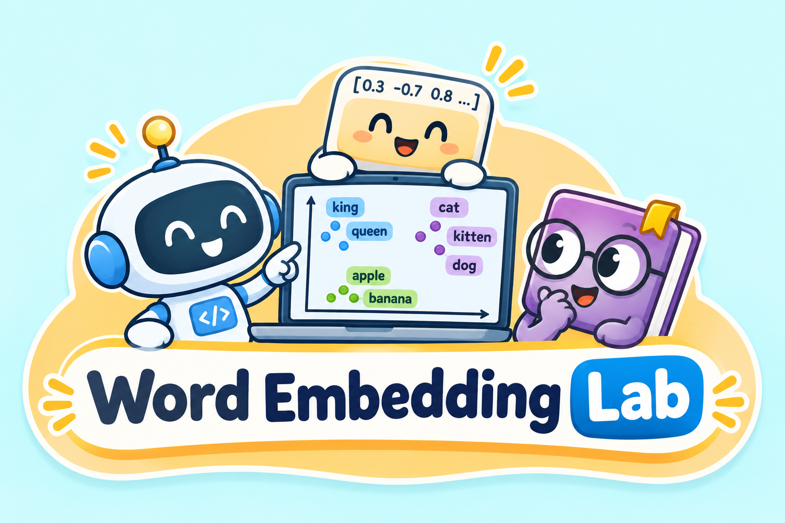
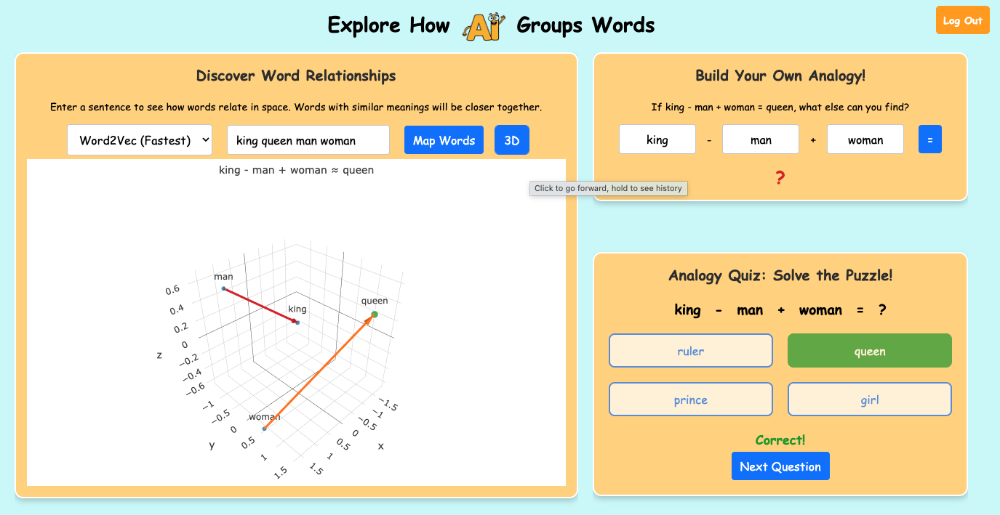

# Word Embedding Lab

<p align="center">
  
</p>

Word Embedding Lab is a web app for middle school students (grades 6–8) to explore how AI represents words as numbers and discovers relationships between them. Students type words, see them placed in a 3D space, build their own word analogies, and solve analogy puzzles.

Word Embedding Lab was originally part of version 2 of the LLM Probability tool. It has since been separated into its own standalone tool.

## Interface



The main page has three parts:

- **Discover Word Relationships** – Enter a few words and click *Map Words*. Each word's embedding is projected to 3D with PCA, so words with similar meanings appear close together.
- **Build Your Own Analogy** – Enter three words (for example, *king − man + woman*) and the model finds the closest word to the result (*queen*). The graph shows the analogy with two arrows (*man → king* and *woman → queen*) and highlights the answer in green.
- **Analogy Quiz** – Students pick the answer to an analogy from four options. After they answer, the analogy is drawn on the graph the same way.

Before starting, students log in with a Student ID and grade and answer one short question about their experience with chatbots.

## Models

| Option in the app | Model |
|---|---|
| Word2Vec (Fastest) | `word2vec-google-news-300` (Gensim) |
| GPT-2 | input embedding layer of `gpt2` (Hugging Face) |
| GPT-2 Medium | input embedding layer of `gpt2-medium` (Hugging Face) |

`app.py` also loads `glove-wiki-gigaword-100` and `EleutherAI/gpt-neo-1.3B`, which are not currently shown in the menu.

## Running locally

Requires Python 3.

```bash
pip install -r requirements.txt
python app.py
```

Then open http://127.0.0.1:5000 in a browser.

The first run downloads the models (several GB in total, mostly Word2Vec and GPT-Neo), so startup can take a while. Later runs use the cached copies.

## Student data

Each login creates a new file in `user_data/` named with a random ID (`<uuid>.json`). It stores:

- `student_id`, `grade`, `login_time`, and the answer to the opening question (`q1`)
- `interactions`: a timestamped list of what the student did:
  - `map_words` – words entered, model, words plotted, or an error
  - `analogy` – the three words, the model's answer, and whether it came from the builder or the quiz
  - `quiz_answer` – question, selected option, correct answer, and `is_correct`
  - `quiz_next`, `logout`

Two students never share a file, even if they enter the same Student ID. If a student logs in twice, they get two files; group by `student_id` and sort by `login_time` to combine them.

Clicking *Log Out* also downloads a copy of the student's file to the computer they are using.

`user_data/` is listed in `.gitignore` so student data is not pushed to GitHub.

## Project structure

```
app.py                 Flask server, models, PCA projection, logging
requirements.txt       Python packages to install
templates/login.html   Login page (Student ID, grade, opening question)
templates/index.html   Main page (word map, analogy builder, quiz)
static/images/         Logo, UI screenshot, and page images
user_data/             Student data files (not committed)
```
